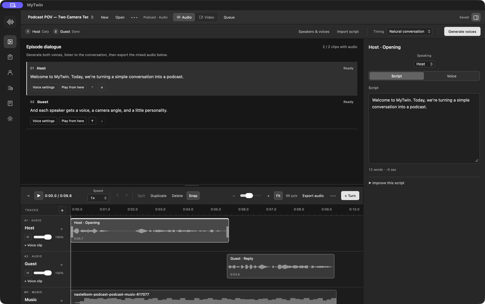

# Fikr Vox

Fikr Vox is an open-source studio for voiceovers, podcasts, and video dubbing on Apple silicon Macs running macOS 13 or later.

[Try the podcast demo](https://fikr.one/vox/#studio) · [Read the user guide](https://fikr.one/vox/docs/) · [GitHub Releases](https://github.com/bigmints/fikr-vox/releases)

[](https://fikr.one/vox/#studio)

## What you can make

- **Voiceovers.** Use Kokoro preset voices or clone a voice from a recording with Qwen3. Both run on your Mac after the model download.
- **Podcasts.** Import dialogue with speaker labels, assign voices, mix voice and music tracks, and export a WAV file.
- **Dubbed videos.** Replace a video's audio with new narration and export an MP4.
- **Scene and presenter videos.** Connect OpenRouter to generate scenes or animate a portrait using an approved voice take.

## Run from source

You'll need an Apple silicon Mac, Node.js 22 or newer, Rust, Xcode with the macOS 26 SDK or newer, Python 3.11 or newer, and `uv` on your PATH. [Tauri prerequisites](https://v2.tauri.app/start/prerequisites/) · [Install uv](https://docs.astral.sh/uv/getting-started/installation/)

```sh
git clone https://github.com/bigmints/fikr-vox.git
cd fikr-vox
npm ci
cargo fetch --locked --manifest-path src-tauri/Cargo.toml --target aarch64-apple-darwin
npm run desktop
```

In the app, open **Settings → Connections → Audio** and download Kokoro or a Qwen3 model. Create a **Story Telling**, **Podcast**, or **Video Dubbing** project, then add a script and generate a voice take. See the [user guide](https://fikr.one/vox/docs/) for packaging, voice profiles, exports, and troubleshooting.

## Contribute

See [Contributing](CONTRIBUTING.md) for the browser development server, repository layout, and tests. Use [GitHub Issues](https://github.com/bigmints/fikr-vox/issues) for bugs and feature requests, and see [Security](SECURITY.md) for private reports.

Fikr Vox is released under the [MIT License](LICENSE). Third-party models, libraries, and connected services have their own terms.
